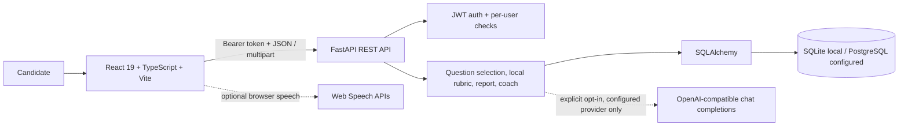

# interviewpro: Demo and Technical Interview Guide

## Honest project summary

**interviewpro** is a full-stack interview-practice web app for students and job seekers. It supports technical, behavioral, resume-based, aptitude/MCQ, communication, and conversational voice practice; saves interview history and reports; and summarizes performance with an evidence-based learning coach.

Be precise about the AI claim: the shipped answer evaluator is a local rubric and lexical baseline, not a language model judging technical truth. Interview questions come from the in-code question bank, with resume-aware question templates. The voice follow-up policy is local and rule-based in the normal UI flow. An OpenAI-compatible JSON completion adapter exists for optional coach-plan enhancement after user consent; the UI currently sends `external_ai_consent: false` when starting voice interviews, so do not claim the live voice demo uses an external LLM.

## Five-minute live walkthrough

Prepare the browser and demo account before the timer starts. Use an account clearly labeled for demonstration, not another person's account or resume. The coach needs at least **three scored answers from completed sessions** before it ranks weak topics. If there is not enough history, its correct behavior is to recommend a diagnostic; do not promise a weakness card on a fresh account.

| Time | Action and talk track |
| --- | --- |
| 0:00-0:20 | **Introduce it.** "interviewpro gives candidates a place to rehearse interview questions, see consistent practice feedback, and decide what to study next." |
| 0:20-1:25 | **Start voice practice.** Open **Start interview**, choose **Live voice interview**, set a difficulty, and start. Allow the browser microphone prompt. Answer the spoken question with a short, genuine response. Show the transcript in the answer box, then submit it. The app may speak the next question and ask an adaptive follow-up. Voice sessions begin with five questions; the local policy can add up to two follow-ups, so keep answers concise. |
| 1:25-2:10 | **Show the saved evaluation.** Finish the session and open the report. Point to the overall practice score, score dimensions, missed concepts, and written feedback. Explain that the current score is calculated locally from a rubric, concept matches, answer structure, and TF-IDF/token overlap; it is not an LLM truth check or hiring prediction. |
| 2:10-2:55 | **Show history and weak topics.** Open **Practice history**, then **Performance analytics**. Explain that completed reports and answer-level evidence are saved per account. The coach requires three scored answers; it ranks observed topics using measured averages and saved missed concepts. Use the account's actual displayed evidence. |
| 2:55-3:35 | **Show the plan.** On the coach card, show the focus topic, measured score, evidence, next actions, time estimate, and completion target. The default plan is built locally from saved evidence. If there is too little history, show the diagnostic state instead and explain why it avoids guessing. |
| 3:35-4:35 | **Explain the architecture and trade-offs.** Use the architecture below. Mention the browser speech API dependency, and that no raw audio is stored by the app. Scoring remains deterministic and inspectable, but lexical matching is limited. |
| 4:35-5:00 | **Close.** "The core value is a repeatable practice-to-feedback-to-next-step loop. A meaningful next improvement would be stronger, validated semantic scoring and broader automated browser tests, while keeping score evidence inspectable." |

### Voice fallback

Speech recognition is provided by the browser's `SpeechRecognition` / `webkitSpeechRecognition` API when available; question and interviewer speech use browser speech synthesis. Browser support and microphone permission vary. If recognition is unavailable or blocked, say so and type the same answer: typed practice is supported. The app sends the transcript text to its API, not raw microphone audio. Browser speech recognition may use the browser vendor's speech service. There is no custom audio-streaming backend in this implementation.

Before the demo, use localhost or HTTPS, test the exact browser and microphone, and approve microphone access for the app. If voice recognition is unreliable, use typed input and accurately describe the browser-dependent voice capability rather than pretending the microphone worked.

## Architecture and data flow



- **Frontend:** React with TypeScript and Vite. Dashboard navigation and view state live in `src/App.tsx`; components use React state/effects. Auth bearer token is held in `sessionStorage`. In development, Vite proxies `/api` to FastAPI.
- **API:** Python 3 + FastAPI. `backend/app/main.py` implements auth, dashboard, interview lifecycle, resume, history, analytics, and coach endpoints. Pydantic validates request bodies.
- **Auth:** passwords are PBKDF2-HMAC-SHA256 hashed (310,000 iterations); signed HS256 bearer tokens expire after 12 hours. Protected handlers resolve the current user and scope interview/resume queries to that user.
- **Persistence:** SQLAlchemy models and Alembic migrations. `User` has one-to-many resume and interview relationships with delete-orphan cascade. `Interview` stores question/answer arrays and report in JSON fields; `Resume` stores parsed fields and the original binary in a database LargeBinary field. SQLite is the local default; `DATABASE_URL` can select PostgreSQL.
- **Interview flow:** `POST /api/interviews/start` selects from `backend/app/questions.py` (questions are in a static bank; resume questions are templates from extracted skills/projects). `POST /api/interviews/{id}/submit-answer` evaluates and saves answers. Voice mode uses `POST /api/interviews/{id}/conversation-turn` to save/evaluate a text transcript and apply a local follow-up policy. Finish/report routes persist and retrieve the report. History is `GET /api/interviews/history`.
- **Scoring:** `backend/app/evaluation.py` uses four dimensions: correctness 35%, relevance 25%, completeness 20%, and clarity 20%. Covered checklist concepts contribute to correctness/completeness; relevance is based on lexical prompt/reference similarity using scikit-learn TF-IDF when available, with token-overlap fallback. This is transparent practice feedback but can miss correct paraphrases and cannot establish factual correctness.
- **Coach:** `POST /api/coach` loads completed sessions for the authenticated user. `backend/app/coach.py` analyzes saved answer scores, topics, feedback, and missed concepts. It requires three scored answers for a baseline; otherwise it returns a diagnostic. Priority values and plans are rule-based; external AI can only enhance the plan after explicit opt-in and a configured API key.
- **Speech:** voice capture/transcription and text-to-speech are browser APIs, not a server-side speech model. Audio is not stored by this application; transcript text and answer metrics are persisted in the interview record.

## Technical trade-offs to discuss

1. **Inspectable scoring vs semantic accuracy:** local, deterministic scoring is explainable and does not depend on a provider call. Token and TF-IDF overlap are only proxies; the score is not a verified correctness judgment.
2. **Flexible JSON session records vs analytics/query ergonomics:** questions, answers, and reports are stored as JSON on each interview. This makes a session easy to persist, while relational answer rows would be easier to aggregate and index at larger scale.
3. **Simple resume retrieval vs storage scaling:** original resume bytes currently live in the database. This is simple for the current app, but production scale would typically move files to private object storage with retention controls.
4. **Browser voice APIs vs consistent cross-browser behavior:** no audio infrastructure is needed, but recognition varies by browser/device and may rely on the browser vendor. Typed answers are the supported fallback.
5. **Development-friendly defaults vs production operations:** SQLite and an in-process auth rate limiter are suitable for local development, not a multi-instance scale target. Production needs managed PostgreSQL, shared rate limiting, strong secret configuration, HTTPS, backups, and upload retention controls.
6. **Separate synthetic ML experiment:** `backend/app/ml/train.py` predicts a simulated session completion-time target. It is not used for interview scoring or coach recommendations; its synthetic metrics must not be presented as candidate-performance accuracy.

## Verified edge cases and test evidence

The repository has backend tests in `backend/tests/test_app.py` and a frontend sign-in test in `src/App.test.tsx`. Test names and assertions verify:

- `GET /api/interviews/history` resolves alongside the integer interview-id route and returns in-progress and completed sessions.
- Another user's interview report is not accessible (404).
- Voice turns save/evaluate an answer, can add a follow-up, and are included in the final report.
- Resume uploads are private to the owner, their original bytes can be downloaded, and extracted skills can inform resume questions.
- Dashboard KPI aggregation handles null aptitude data, duration fields, completed-session filtering, and normalized duplicate skill names.
- The learning coach ignores unfinished records, uses only the signed-in user's completed evidence, and returns a diagnostic with no invented weakness when history is insufficient.
- External coach enhancement is not called without opt-in; the test checks the explicit-consent boundary.

This working directory is **not a Git repository**, so Git history/commit-based bug attribution is unavailable. Do not claim personal debugging anecdotes beyond the test-covered cases above.

## Local run and verification

From the project root on Windows PowerShell:

```powershell
# Terminal 1: API
cd backend
.\.venv\Scripts\Activate.ps1
alembic upgrade head
uvicorn app.main:app --reload

# Terminal 2: frontend (from the project root)
npm run dev
```

Open the Vite URL (normally `http://localhost:5173`). Backend tests: `cd backend; pytest -q`. Frontend tests and production build: `npm test -- --reporter=verbose` and `npm run build`.

**Verification in this preparation pass:** backend tests passed (14); frontend test passed (1); TypeScript/Vite production build passed. The local API/frontend could not be reached through the available browser tool in this environment, so a live browser-console/network inspection and physical microphone-permission test are not claimed. Test microphone support in the browser you will present with.
